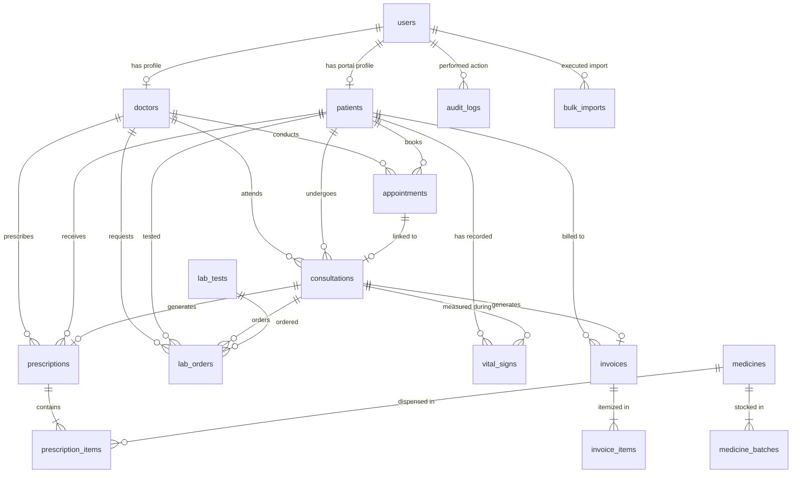

# Clinic Management System

[](https://laravel.com)
[](https://www.postgresql.org)
[](https://getbootstrap.com)
[](https://github.com)
[](LICENSE)

A production-ready, sophisticated, enterprise-grade Clinic Management System (CMS) & Electronic Medical Records (EMR/EHR) platform engineered with **Laravel 13**, **PostgreSQL 18**, **Bootstrap 5.3**, and **Bootstrap Icons**.

The application is designed for hospitals, outpatient clinics, healthcare centers, and clinical practices. It is bundled with all frontend libraries stored directly inside the application folder, enabling **100% offline, standalone execution across private hospital local area networks (LAN) and air-gapped intranets without any external internet connection**.

---

## Table of Contents

- [Key Architecture & Capabilities](#key-architecture--capabilities)
- [Role-Based Access Control (RBAC)](#role-based-access-control-rbac)
- [System Requirements](#system-requirements)
- [Installation & Quick Start](#installation--quick-start)
- [PostgreSQL 18 Setup Guide](#postgresql-18-setup-guide)
  - [Configuring PostgreSQL in Laragon](#configuring-postgresql-in-laragon)
  - [Native PostgreSQL 18 Service](#native-postgresql-18-service)
- [Database Migrations & Seeding](#database-migrations--seeding)
- [Pre-Seeded Demo User Accounts](#pre-seeded-demo-user-accounts)
- [Admin Bulk Data Import Center](#admin-bulk-data-import-center)
  - [Patients CSV Import Specification](#1-patients-csv-import-specification)
  - [Pharmacy Medicines & Stock Batches Specification](#2-pharmacy-medicines--stock-batches-specification)
  - [Clinical Staff & Doctors Specification](#3-clinical-staff--doctors-specification)
- [Offline Intranet Operation](#offline-intranet-operation)
- [Entity-Relationship Diagram (ERD)](#entity-relationship-diagram-erd)
- [Directory Structure](#directory-structure)
- [License](#license)

---

## Key Architecture & Capabilities

1. **Electronic Medical Records (EMR / EHR)**
   - Complete digital patient dossier tracking history of present illness (HPI), chief complaints, and physical examination notes.
   - Primary and secondary diagnoses with **ICD-10 clinical coding** support.
   - Integrated digital prescription issuance and diagnostic lab order dispatching.
   - Formal printable Clinical Encounter Summary notes for medical records.

2. **Nursing Triage & Vital Signs**
   - Rapid vitals entry: Systolic/Diastolic Blood Pressure (mmHg), Pulse Rate (bpm), Body Temperature (°C), Respiratory Rate, Oxygen Saturation (SpO2), Height (cm), Weight (kg).
   - Automated dynamic **Body Mass Index (BMI)** computation.
   - Prominent clinical safety warnings (e.g., critical drug allergies displayed in red alerts across all stations).

3. **Appointment Scheduling & Live Patient Queue**
   - Appointment booking with specialist allocation, appointment types (Routine, Consultation, Follow-up, Urgent/Emergency).
   - Real-time patient flow status transitions: `Scheduled` &rarr; `Checked-In` &rarr; `In-Consultation` &rarr; `Completed` (or `Cancelled` / `No-Show`).
   - One-click check-in and instantaneous EMR consultation initiation.

4. **Pharmacy & FEFO Batch Inventory Management**
   - Complete drug catalog with therapeutic categories, generic names (API), strength, units (Tablet, Capsule, Syrup, Inhaler, Injection), and reorder thresholds.
   - **First-Expired, First-Out (FEFO) Inventory Tracking**: Multi-batch inventory tracking batch numbers, purchase dates, expiry dates, and remaining quantities.
   - Prescription fulfillment queue: Pharmacist verifies stock availability and dispenses medications, with automatic stock deduction from the earliest non-expired active batches.
   - Automatic low-stock warnings when inventory drops below configured reorder levels.

5. **Diagnostic Laboratory & Pathology Management**
   - Test catalog with standard biological reference intervals, specimen guidelines, and fee schedules.
   - Diagnostic order processing with qualitative/quantitative result recording.
   - Clinical result flags: `Normal`, `Abnormal`, and `Critical Alert`.

6. **Patient Billing & Revenue Cycle Management**
   - Consolidated billing automatically compiling physician consultation fees, dispensed medications, and diagnostic lab tests.
   - Partial payments, balance due calculation, tax amounts, and insurance copay discounts.
   - Payment channels: Cash, Credit/Debit Card, Corporate Insurance, and Direct Bank Transfer.
   - Professional, printable official hospital receipts.

7. **Admin Bulk Data Import Center**
   - High-throughput CSV importer for onboarding Patients, Pharmaceutical Medicines with Stock Batches, and Clinical Staff accounts.
   - Built-in downloadable pre-formatted sample CSV templates.
   - Automatic header normalization, row-by-row validation, transactional rollback, and granular row-level error reporting (e.g. Line 4: invalid date format; Line 7: email duplicate).

8. **Security & Clinical Audit Logs**
   - Immutable security audit trail recording all user logins, logouts, patient registrations, prescription dispensings, invoice payments, and bulk imports with timestamps, client IP addresses, and user-agent details.

---

## Role-Based Access Control (RBAC)

The system includes a role verification middleware (`RoleMiddleware`) supporting 6 distinct healthcare personas:

| Role | Access Scope |
|---|---|
| **Admin** | Full system control: User management, staff profiles, system settings, audit logs, and **Bulk Data Import Center**. |
| **Doctor** | Clinical appointments queue, patient dossier review, EMR consultations, ICD-10 diagnostic coding, prescribing, and ordering lab panels. |
| **Nurse** | Triage station, vitals measurement logging, patient intake check-in, allergy documentation. |
| **Pharmacist** | Prescription dispensing terminal, medicine catalog, batch inventory restock, FEFO stock deductions, expiry date monitoring. |
| **Receptionist** | Front-desk patient registration, appointment scheduling, queue management, invoice issuance, and payment collection. |
| **Patient** | Patient portal: View appointment schedule, medical history, active prescriptions, and billing receipts. |

---

## System Requirements

- **PHP**: `>= 8.3` (PHP 8.3 or PHP 8.4 recommended) with extensions: `pdo`, `pdo_pgsql`, `pgsql`, `mbstring`, `openssl`, `curl`, `fileinfo`, `gd`.
- **Database**: **PostgreSQL 18** (or PostgreSQL 15+ / 16 / 17 / 18).
- **Composer**: `>= 2.7`
- **Node.js**: (Optional / Not needed in production since compiled vendor assets are already bundled in `public/vendor/`).
- **Web Server**: Apache, Nginx, or Laragon.

---

## Installation & Quick Start

### 1. Clone or Copy the Repository
Place the project inside your web server directory (e.g. `C:\laragon\www\clinic-management-system` or `c:\xampp\htdocs\clinic-management-system`).

### 2. Configure Environment (`.env`)
Copy the environment template if `.env` does not exist:
```bash
cp .env.example .env
```

Ensure your `.env` is configured for **PostgreSQL 18**:
```env
APP_NAME="Clinic Management System"
APP_ENV=local
APP_KEY=base64:Ucmzy5jVfNcvT9JBAYLVck9so65Jjrm/9UvlE7YffN4=
APP_DEBUG=true
APP_URL=http://localhost:8000

DB_CONNECTION=pgsql
DB_HOST=127.0.0.1
DB_PORT=5432
DB_DATABASE=clinic_management_system
DB_USERNAME=postgres
DB_PASSWORD=postgres
DB_SCHEMA=public
DB_SSLMODE=prefer

SESSION_DRIVER=file
CACHE_STORE=file
QUEUE_CONNECTION=sync
```

### 3. Generate Application Key (if not already set)
```bash
php artisan key:generate
```

---

## PostgreSQL 18 Setup Guide

### Configuring PostgreSQL in Laragon

If you are using **Laragon**:
1. Open Laragon, go to **Menu &rarr; PostgreSQL &rarr; Service &rarr; Start**.
2. If PostgreSQL is not yet added to Laragon:
   - Download the official PostgreSQL 18 binaries (Windows x64 ZIP) from [EnterpriseDB / PostgreSQL.org](https://www.postgresql.org/download/windows/).
   - Extract the folder into `C:\laragon\bin\postgresql\postgresql-18.x`.
   - In Laragon, click **Menu &rarr; PostgreSQL &rarr; Version** and select `postgresql-18.x`.
   - Click **Start All**.
3. Create the database:
   - Open Laragon Terminal and run:
     ```bash
     createdb -U postgres clinic_management_system
     ```
   - Or open HeidiSQL / pgAdmin / DBeaver connected to `127.0.0.1:5432`, and execute:
     ```sql
     CREATE DATABASE clinic_management_system;
     ```

### Native PostgreSQL 18 Service (Windows / Linux / macOS)

1. **Windows**: Use the official PostgreSQL 18 Windows installer. During installation, set the port to `5432` and master password to `postgres` (or your chosen password, matching your `.env`).
2. Run PostgreSQL command prompt (`psql`):
   ```sql
   CREATE DATABASE clinic_management_system;
   ```
3. **Linux (Ubuntu/Debian)**:
   ```bash
   sudo apt update
   sudo apt install postgresql-18 postgresql-contrib
   sudo -u postgres psql -c "CREATE DATABASE clinic_management_system;"
   sudo -u postgres psql -c "ALTER USER postgres PASSWORD 'postgres';"
   ```

---

## Database Migrations & Seeding

Once PostgreSQL 18 is running and the database `clinic_management_system` is created, run the migrations and comprehensive seeder:

```bash
# Execute schema migrations
php artisan migrate

# Seed complete hospital demo data
php artisan db:seed
```

> **Note**: To wipe and re-seed clean demonstration data at any time:
> ```bash
> php artisan migrate:fresh --seed
> ```

---

## Pre-Seeded Demo User Accounts

The database seeder initializes ready-to-test accounts for every hospital role. All demo accounts share the password: **`password123`**.

| Role | Name | Email Address | Password | Clinical Station / Specialty |
|---|---|---|---|---|
| **Admin** | Dr. Eleanor Sterling | `admin@clinic.local` | `password123` | Hospital Executive & Chief Medical Admin |
| **Doctor** | Dr. Marcus Vance | `doctor@clinic.local` | `password123` | Cardiology (Room 201) |
| **Doctor** | Dr. Sarah Jenkins | `dr.sarah@clinic.local` | `password123` | Pediatrics (Room 105) |
| **Doctor** | Dr. Robert Chen | `dr.robert@clinic.local` | `password123` | Internal Medicine (Room 102) |
| **Nurse** | Clara Barton | `nurse@clinic.local` | `password123` | Triage Station & Clinical Vitals |
| **Pharmacist** | Walter Reed | `pharmacist@clinic.local` | `password123` | Pharmacy Central Dispensing |
| **Receptionist** | Alice Cooper | `receptionist@clinic.local` | `password123` | Outpatient Intake & Registration Desk |
| **Patient** | Johnathan Doe | `patient@clinic.local` | `password123` | Patient Portal (Code: `PAT-2026-0001`) |

> **Quick Login Helper**: On the login page (`/login`), click any role pill to instantly fill the credentials!

---

## Admin Bulk Data Import Center

Located under **Administration &rarr; Bulk Import Data** (`/admin/bulk-import`), the Bulk Import Center allows administrators to batch-import hundreds or thousands of records via CSV with automatic validation and error logging.

Pre-packaged sample CSV files are included in the project under the `sample-imports/` folder:
- `sample-imports/sample_patients.csv`
- `sample-imports/sample_medicines.csv`
- `sample-imports/sample_staff.csv`

### 1. Patients CSV Import Specification

**Sample Download**: Available directly via the UI button *Download Patients.csv* or route `/admin/bulk-import/template/patients`.

| Column | Type | Required | Description / Example |
|---|---|---|---|
| `first_name` | String | **Yes** | e.g. `Alexander` |
| `last_name` | String | **Yes** | e.g. `Hamilton` |
| `date_of_birth` | Date | **Yes** | Format: `YYYY-MM-DD` (e.g. `1980-01-11`) |
| `gender` | Enum | **Yes** | `male`, `female`, or `other` |
| `blood_group` | Enum | No | `A+`, `A-`, `B+`, `B-`, `AB+`, `AB-`, `O+`, `O-`, or `Unknown` |
| `phone` | String | **Yes** | Contact phone number (e.g. `+1-555-0901`) |
| `email` | Email | No | e.g. `alex.hamilton@example.com` |
| `national_id` | String | No | Passport or National ID (e.g. `NID-77112233`) |
| `address` | Text | No | Residential address |
| `allergies` | Text | No | Known medical/drug allergies (e.g. `Penicillin, Aspirin`) |
| `chronic_diseases`| Text | No | Chronic conditions (e.g. `Hypertension, Type 2 Diabetes`) |
| `emergency_contact_name` | String | No | Next of kin name |
| `emergency_contact_phone`| String | No | Emergency contact phone |
| `emergency_contact_relation` | String | No | Relation (e.g. `Spouse`, `Parent`) |
| `insurance_provider` | String | No | e.g. `BlueCross BlueShield` |
| `insurance_policy_number`| String | No | e.g. `POL-BC-1122` |

### 2. Pharmacy Medicines & Stock Batches Specification

**Sample Download**: Route `/admin/bulk-import/template/medicines`.

| Column | Type | Required | Description / Example |
|---|---|---|---|
| `code` | String | No | Optional. If empty, auto-generated as `MED-XXXX` |
| `name` | String | **Yes** | Trade brand name (e.g. `Ciprofloxacin 500mg`) |
| `generic_name` | String | No | Active ingredient (e.g. `Ciprofloxacin Hydrochloride`) |
| `category` | String | **Yes** | e.g. `Antibiotic`, `Analgesic`, `Cardiovascular` |
| `unit` | String | **Yes** | `Tablet`, `Capsule`, `Syrup`, `Injection`, `Inhaler`, etc. |
| `dosage_form` | String | No | Strength (e.g. `500mg`, `100ml`) |
| `manufacturer`| String | No | e.g. `Bayer Healthcare` |
| `unit_cost` | Decimal | No | Clinic purchase cost per unit (e.g. `0.30`) |
| `selling_price`| Decimal | **Yes** | Retail selling price per unit (e.g. `0.85`) |
| `reorder_level`| Integer | No | Low-stock threshold (Default: `10`) |
| `batch_number` | String | No | Initial stock batch identifier (e.g. `BAT-CIP-2026-X`) |
| `expiry_date` | Date | No | Format: `YYYY-MM-DD` (e.g. `2028-09-30`) |
| `quantity` | Integer | No | Initial received stock quantity (e.g. `500`) |
| `supplier` | String | No | Pharmaceutical supplier / distributor |

### 3. Clinical Staff & Doctors Specification

**Sample Download**: Route `/admin/bulk-import/template/staff`.

| Column | Type | Required | Description / Example |
|---|---|---|---|
| `name` | String | **Yes** | Full name with title (e.g. `Dr. Gregory House`) |
| `email` | Email | **Yes** | Unique login email (e.g. `house@clinic.local`) |
| `role` | Enum | **Yes** | `doctor`, `nurse`, `pharmacist`, `receptionist`, or `admin` |
| `phone` | String | No | Phone number |
| `password` | String | No | Default: `password123` |
| `specialization`| String | No | Required if role is doctor (e.g. `Infectious Diseases`) |
| `license_number`| String | No | Medical license number |
| `qualification` | String | No | Degrees & credentials (e.g. `MD, FACP`) |
| `consultation_fee`| Decimal| No | Doctor's fee (e.g. `95.00`) |
| `room_number` | String | No | Office / Room number (e.g. `Room 301`) |

---

## Offline Intranet Operation

In compliance with hospital data security policies and intranet/air-gapped operation:
- **Zero External CDN Dependencies**: All CSS stylesheets, JavaScript files, and icon webfonts are hosted locally within the project.
- Assets reside in:
  - `public/vendor/bootstrap/css/bootstrap.min.css` (Bootstrap 5.3.3)
  - `public/vendor/bootstrap/js/bootstrap.bundle.min.js`
  - `public/vendor/bootstrap-icons/bootstrap-icons.min.css` (Bootstrap Icons 1.11.3)
  - `public/vendor/bootstrap-icons/fonts/bootstrap-icons.woff` & `bootstrap-icons.woff2`
  - `public/vendor/chartjs/chart.umd.js` (Chart.js UMD bundle)
  - `public/css/clinic.css` (Clinical UI Theme)
- All Blade views reference local assets using `{{ asset('vendor/...') }}`.

---

## Entity-Relationship Diagram (ERD)



---

## Directory Structure

```
clinic-management-system/
├── app/
│   ├── Http/
│   │   ├── Controllers/
│   │   │   ├── AppointmentController.php   # Appointment scheduling & queueing
│   │   │   ├── AuditLogController.php      # Administrative security audit trail
│   │   │   ├── AuthController.php          # Authentication & profile management
│   │   │   ├── BillingController.php       # Invoices, payments & print receipts
│   │   │   ├── BulkImportController.php    # Admin Bulk Data CSV Import Hub
│   │   │   ├── ConsultationController.php   # Clinical EMR encounters & diagnosis
│   │   │   ├── DashboardController.php     # Operational metrics & realtime queue
│   │   │   ├── DoctorController.php        # Medical specialists roster & schedules
│   │   │   ├── LabController.php           # Pathology catalog & lab test orders
│   │   │   ├── PatientController.php       # Patient dossier & clinical histories
│   │   │   ├── PharmacyController.php      # Medicine inventory, batches & dispensing
│   │   │   └── VitalSignController.php     # Nursing triage & physiological vitals
│   │   └── Middleware/
│   │       └── RoleMiddleware.php          # Role-Based Access Control gate
│   ├── Models/                             # 16 Eloquent Models with relationships
│   └── Services/
│       └── BulkImportService.php           # CSV parsing, transaction & validation engine
├── database/
│   ├── migrations/                         # 13 PostgreSQL 18-optimized schema migrations
│   └── seeders/
│       └── DatabaseSeeder.php              # Full clinic seed dataset with 6 roles
├── public/
│   ├── css/
│   │   └── clinic.css                      # Modern clinical interface design system
│   └── vendor/                             # Bundled offline assets (Bootstrap, Icons, Chart.js)
├── resources/
│   └── views/                              # 20+ Blade templates organized by clinical module
├── sample-imports/                         # Pre-formatted sample CSV datasets
│   ├── sample_medicines.csv
│   ├── sample_patients.csv
│   └── sample_staff.csv
├── routes/
│   └── web.php                             # Authenticated & role-guarded web routes
└── README.md                               # Comprehensive system documentation
```

---

## Development Cheatsheet

```bash
# Start local PHP development server
php artisan serve

# Run database migrations
php artisan migrate

# Seed database with sample hospital data
php artisan db:seed

# Clear application cache
php artisan optimize:clear
```

---

## License

The Clinic Management System is open-sourced software licensed under the [MIT license](LICENSE).
